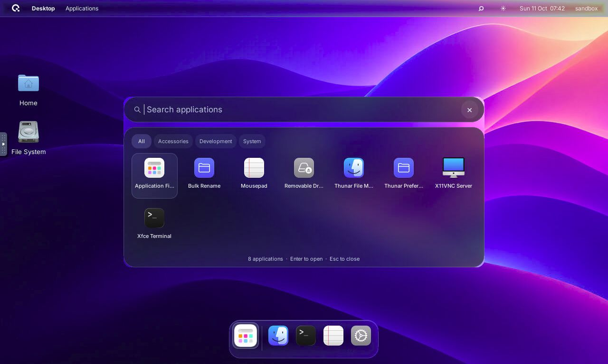
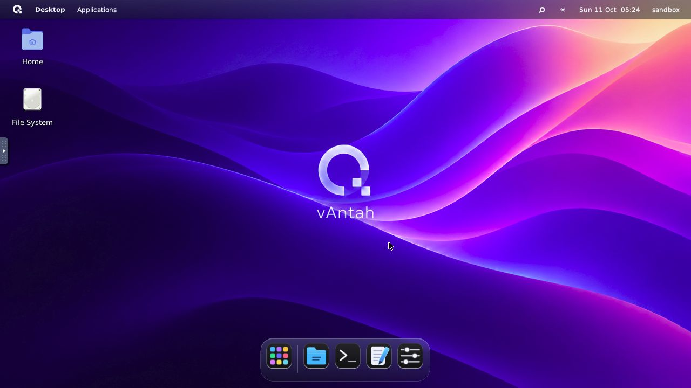
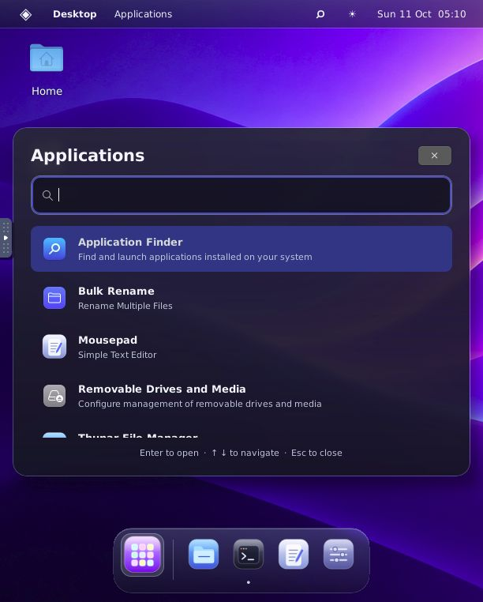

<p align="center"><picture><source media="(prefers-color-scheme: dark)" srcset="assets/logo-light.svg"></picture></p>

# vAntah

A native glass desktop shell for Alpine Linux: translucent desktop chrome,
a refractive dock, application search, dark mode, and motion controls.
The current source uses KWin X11 and the real KWin Glass compositor effect.
The published v0.1.1 installer below still provides the earlier Picom demo.

Running KWin Glass desktop with MacTahoe icons:



Earlier v0.1.1 Docker demo:



Application search in the themed sandbox:



Download the source, logo, wallpaper, and screenshots from the
[public v0.1.1 release](https://github.com/Up-to-code/vantah/releases/tag/v0.1.1).

## One-command installer

Requires Docker with a running Linux engine, `curl`, `tar`, and `shasum` or
`sha256sum`. On macOS use Docker Desktop or Colima; on Linux use Docker Engine.
Windows users can run the command inside WSL with Docker integration.

```sh
curl -fsSL https://raw.githubusercontent.com/Up-to-code/vantah/v0.1.1/try.sh | sh
```

The installer downloads the versioned release, checks its SHA-256 checksum,
builds the image for your machine, and starts a localhost-only desktop. Open the
URL it prints. Running it again restarts the same container. Set `VANTAH_PORT`,
`VANTAH_CONTAINER`, or `VANTAH_INSTALL_DIR` to customize it. It requires no sudo and
does not install Docker or change your host desktop. Stop it with
`docker stop vantah-demo`. Your container files remain available. If an earlier version already owns
`vantah-demo`, use `VANTAH_CONTAINER=vantah-demo-v011` on the `sh` side of the
installer command, and set a free `VANTAH_PORT`. Existing containers are preserved.

## Build from source

Requires Docker with a running Linux engine. On macOS, Docker Desktop or Colima
can provide that engine.

```sh
git clone https://github.com/Up-to-code/vantah.git
cd vantah
sh sandbox/run.sh
```

Open <http://127.0.0.1:6081/vnc.html?autoconnect=true&resize=scale>.
The demo runs without host mounts as a non-root user, drops Linux capabilities,
and binds its browser port to localhost. It has no VNC password, so keep the
port on localhost. The container is named `vantah-demo`; stop and restart
it with `docker stop vantah-demo` and `docker start vantah-demo`.

The source is baked into the image. Rebuild after editing it. `run.sh` refuses to
replace an existing container; use a different name and port to keep its files:
`sh sandbox/run.sh vantah-demo-v2 6082`.

The current source installs pinned [MacTahoe icons](https://github.com/vinceliuice/MacTahoe-icon-theme),
[GTK themes](https://github.com/vinceliuice/MacTahoe-gtk-theme), cursors, and
[KWin Aurorae decorations](https://github.com/vinceliuice/MacTahoe-kde).
These are open-source Linux themes inspired by macOS Tahoe, not extracted Apple
system assets or an exact macOS 27 theme. Inter is the desktop font.
[Apple 27 and Siri reference catalog](docs/apple-design-references.md) records
which official screenshots informed the work and what still differs.
The wallpaper is an original project asset. vAntah uses the Qentrah logo supplied
by the project owner. The earlier v0.1.1 demo screenshots retain its older appearance.

## Native implementation

A custom native desktop shell for the Alpine Linux sandbox. The shell replaces
Xfce's panels with a glass menu bar, application search, and an application dock.
GTK 3 draws the UI and libwnck controls real windows. KWin X11 6.5.6 manages
windows; the pinned KWin Glass shader samples and refracts the live backdrop.
[Backend details and source revisions](docs/kwin-glass.md) explain the Alpine
GLX compatibility patch and software rendering. Building KWin requires several
GB of free disk space and a substantial first build.

## Controls

- Click the magnifier, app-grid dock icon, or press **Super+Space** to search installed applications.
- Type a name, use arrow keys, and press Enter to launch. Escape closes search.
- Click a dock app to open it or cycle through its windows. Dots show running apps.
- Right-click a pinned app for a new window. Additional windows appear in the dock or its overflow menu.
- Click the sun/moon to switch dark and light appearance. The appearance also applies to GTK apps and window frames.
- Use the Qentrah logo menu to enable **Reduce Motion** or change wallpaper.
- Click the clock for a calendar. Time is shown in Africa/Cairo.

Dark mode is the default. Preferences are saved in `~/.config/alpine-shell/settings.json`.
The shell starts automatically with the Alpine desktop.

## Source and installation

`shell.py` is the native shell, `shell.css` defines its UI, and `kwinrc` configures
the real Glass effect. The Picom files remain for the earlier session backend.
MacTahoe supplies the active dock, launcher, application, and system icons.
The original SVGs in `icons/` remain as a fallback when MacTahoe is unavailable. Dock hover zoom uses cached images and native animation timers.
Dock symbols render at 48 pixels with a 54-pixel hover size, inside 56-pixel
click targets. Themed artwork keeps its upstream shape and color rather than adding a fixed black tile.
The source installed in Alpine is `~/.local/share/alpine-shell`.

`fix-vnc.py` patches the sandbox's noVNC client so Mac Command stays Linux
Super, releases modifiers after an intercepted host shortcut, and clears
remote modifier state when reconnecting. This prevents ordinary letters from
becoming menu accelerators. The viewer also fits the fixed KWin framebuffer when opening older
`resize=remote` links. Reload the noVNC browser after installation.
Upstream JavaScript backups are retained beside the modified files with the
suffix `.before-alpine-shell`. The modified noVNC files retain their upstream
MPL-2.0-or-later license; that license is separate from this shell's MIT license.

From this directory on the Mac:

```sh
sh install.sh alpine-gui
```

`sandbox/install-appearance.sh` downloads pinned theme sources and preserves their
licenses in `/usr/share/doc/vantah-appearance/`: icons GPL-3.0, GTK MIT, and
KDE decorations LGPL-3.0. These remain separate from the shell's license.
The installer disables the unrelated GNOME theme switcher and uses upstream
silent mode to work in headless Alpine builds. The shell code, wallpaper, and dock icons are MIT licensed. The Qentrah logo
is project-owner branding, excluded from the artwork license. This is an original Linux shell inspired by Apple
design, not Apple's iOS or macOS code and not an official 2027 Apple theme.

## Restore

The KWin session retains your Xfce configuration and sandbox files. The earlier
Picom session exposes **Restore Xfce Panels**. Its autostart entry can be disabled
by renaming `~/.config/autostart/alpine-shell.desktop`; the KWin Docker session
instead starts through `sandbox/start-kwin.sh`.

## Current scope

This version targets the sandbox's single VNC display. It provides desktop
chrome, app search, window activation, live glass blur, and window animations.
It does not replace application UI, implement a global application menu, or
provide Apple's proprietary UI or minimize-to-dock engine. Real convex refraction
and RGB dispersion come from the separately licensed open-source Glass effect.
GTK accessibility labels and keyboard navigation are included. Rams quick_review
was attempted, but the account's review credit limit prevented a result.

## Development checks

```sh
python3 -m py_compile shell.py fix-vnc.py
python3 sandbox/test-installer.py
sh -n try.sh install.sh run-shell.sh sandbox/run.sh sandbox/start-desktop.sh
# Test the patched client exported from the running demo:
docker cp vantah-demo:/usr/share/novnc/core/input/keyboard.js /tmp/alpine-keyboard.js
node sandbox/test-vnc-keyboard.cjs /tmp/alpine-keyboard.js
docker cp vantah-demo:/usr/share/novnc/app/ui.js /tmp/vantah-vnc-ui.js
node sandbox/test-vnc-sizing.cjs /tmp/vantah-vnc-ui.js
```

The keyboard regression simulates a swallowed Mac Command release and checks
that it is released before the next `e` key, without sending Linux Alt.

The existing Alpine sandbox was upgraded with MacTahoe, booted, and checked with
KWin and `glass_x11` loaded. [Appearance checks](docs/appearance-testing.md) record
the tested controls and limitations. The revised multistage Docker image has not yet
been validated from a clean build. The earlier v0.1.1 image and installer were
built and booted, and the patched noVNC keyboard regression passed.
